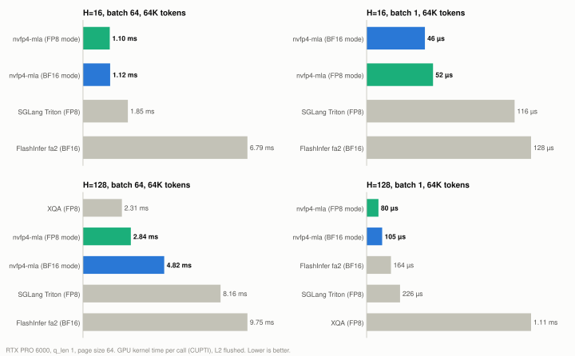
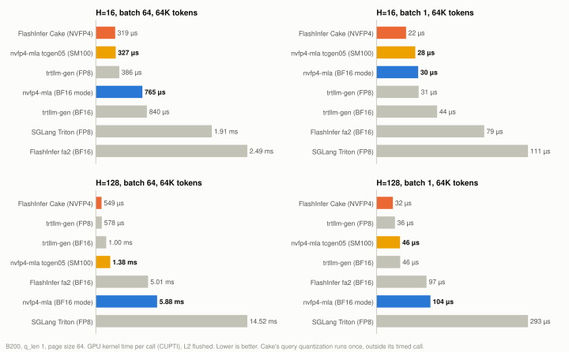
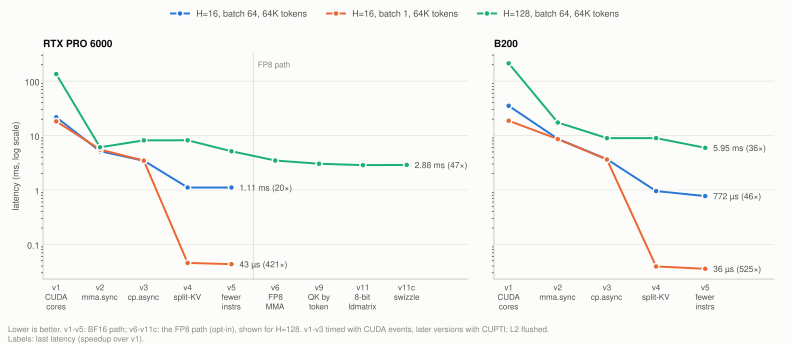
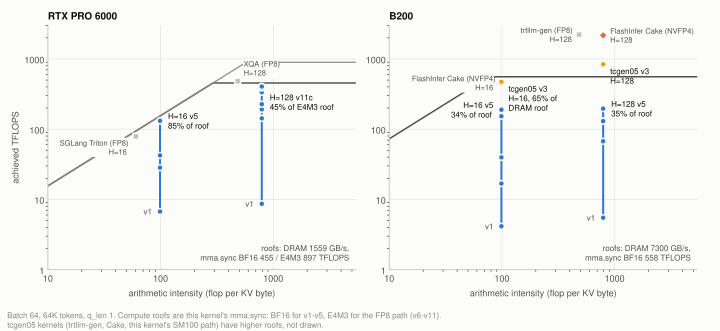
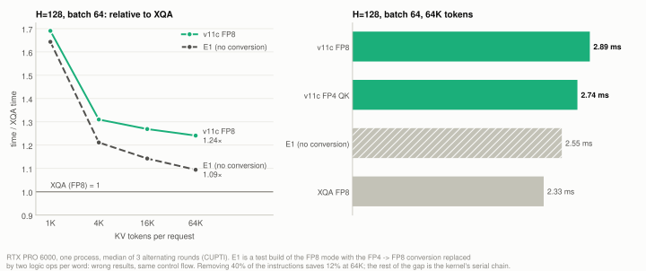
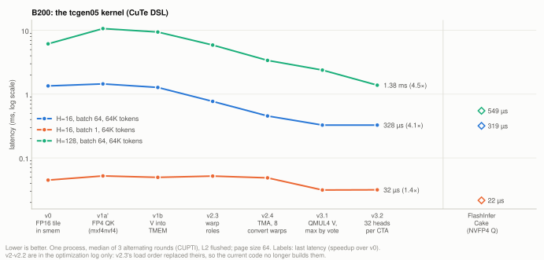

# NVFP4 Dense MLA Decode kernel

MLA decode attention (DeepSeek-style, weight-absorbed) that reads the **FlashInfer NVFP4 paged KV cache** directly.
I added this cache format and its quantize/append kernel to FlashInfer in
[flashinfer#4676](https://github.com/flashinfer-ai/flashinfer/pull/4676); this repository is the decode side.
The latent KV is stored as E2M1 with one E4M3 scale per 16 channels and the RoPE part as FP8, so one token is
352 bytes (FP8: 576, BF16: 1152). By default the kernel dequantizes in registers and keeps Q, P and the MMA in BF16
with FP32 accumulation; an FP8 mode (E4M3 Q, K, V, P and MMA) is up to 1.8x faster on compute-bound shapes.

There are two kernels, both written from scratch: a CUDA kernel (`mma.sync`, `cp.async`, split-KV) for
**SM120 (RTX PRO 6000)**, which also runs on SM100, and a warp-specialized `tcgen05` kernel in CuTe DSL for
**SM100 (B200)** (`nvfp4_mla.sm100`).

Status: dense decode, one query token per request (see [Roadmap](#roadmap)). How both kernels were built, step by
step with the hypothesis, the profile and the result of each change (including the ones that did not work): the CUDA
kernel from a CUDA-core version to 84-85% of DRAM bandwidth and an FP8 mode for compute-bound shapes, and the SM100
kernel from a serial `tcgen05` version through warp specialization to V converted by `QMUL4`, 3% faster than
FlashInfer Cake at 16 heads, batch 64 and 64K tokens: [docs/optimization-log.md](docs/optimization-log.md).

## Why

FlashInfer can write an MLA KV cache in NVFP4 (#4676). Who can read it back for dense decode, as of 2026-11-11
(FlashInfer v0.7.3 and v0.7.4rc1, vLLM v0.33.0, SGLang v0.5.23, TensorRT-LLM v1.4.0rc3):

- **SM12x** (RTX PRO 6000 and RTX 50 series are SM120, DGX Spark is SM121): FlashInfer, vLLM and SGLang have no
  dense NVFP4 MLA decode. FlashInfer's experimental b12x package (SM12x) has a dense MLA for BF16 and FP8 caches
  (compared below) and NVFP4 records only for its sparse MLA, in its own record layout. vLLM's dense MLA backends
  take BF16 or FP8 KV only, and its NVFP4 MLA cache (`nvfp4_ds_mla`) is for sparse MLA on SM100 only. SGLang's FP4 MLA cache uses its own layout and is dequantized to
  BF16 before attention. TensorRT-LLM's `fp4_mla` (FP4 query, KV and P, its own cache layout) is validated on SM100
  and SM107 only.
- **SM100:** FlashInfer v0.7.3 added `cake_mla_nvfp4_paged_decode` (experimental, needs CUDA 13.4), which reads
  this cache with `tcgen05` MMA and an NVFP4 query. On B200 this repository's SM100 kernel is 3% faster than it at 16
  heads, batch 64 and 64K tokens; Cake is 1.1-1.9x faster at smaller 16-head shapes and up to 2.9x with 128 heads
  (see [Performance](#performance)), with 1.4-1.7x the error against the unquantized KV (see [Accuracy](#accuracy)). An
  open vLLM PR ([#63203](https://github.com/vllm-project/vllm/pull/63203)) uses it for `--kv-cache-dtype nvfp4` on dense MLA
  models.
- FlashInfer's generic MLA decode (`trtllm_batch_decode_with_kv_cache_mla`) still raises for this cache.

This kernel reads the cache on SM120 and SM100 and keeps the query in BF16 by default; its FP8 mode trades a few
percent of accuracy for speed on compute-bound shapes.

## Requirements

- NVIDIA Blackwell GPU: SM120 (RTX PRO 6000) or SM100 (B200). Other Blackwell parts (SM103, SM121) are not tested.
- CUDA toolkit 12.8 or newer, with `nvcc` on `PATH` (`precision="fp4-qk"` needs 12.9). With 13.2 or newer the
  kernel uses the native FP4/FP8 to BF16 conversion instructions; older toolkits convert through FP16, which gives the
  same values with a few more instructions.
- PyTorch 2.7 or newer for the same CUDA major version, and `ninja`.
- `flashinfer-python >= 0.7.0` to write the cache (and for the tests and benchmarks).
- For the SM100 kernel: `nvidia-cutlass-dsl[cu13] >= 4.8.1` (`pip install -e ".[sm100]"`).

Tested with CUDA 13.4.2, PyTorch 2.12.0, Python 3.13 and FlashInfer 0.7.4rc1 on RTX PRO 6000 Blackwell Server
Edition and B200; the benchmarks below use this setup. The tests also pass with CUDA 13.3 and FlashInfer 0.7.0 and
0.7.3.

## Install

```bash
git clone https://github.com/elwhyjay/nvfp4-mla.git
cd nvfp4-mla
pip install -e .            # in the same environment as SGLang / vLLM / FlashInfer
```

The CUDA extension is compiled on the first call (about one minute) and cached in `~/.cache/torch_extensions`.
Set `NVFP4_MLA_VERBOSE=1` to see the build output.

## Usage

```python
import flashinfer
import nvfp4_mla

# NVFP4 MLA paged cache, written by FlashInfer
ckv_cache = torch.empty(num_pages, page_size, 256, dtype=torch.uint8, device="cuda")
ckv_sf_cache = torch.empty(num_pages, page_size, 32, dtype=torch.float8_e4m3fn, device="cuda")
kpe_cache = torch.empty(num_pages, page_size, 64, dtype=torch.float8_e4m3fn, device="cuda")
flashinfer.nvfp4_quantize_append_paged_mla_kv_cache(
    ckv, kpe, batch_indices, positions, ckv_cache, ckv_sf_cache, kpe_cache,
    kv_indices, kv_indptr, kv_last_page_len, ckv_scale, kpe_scale)

out = nvfp4_mla.decode(
    q_nope, q_pe,                        # [B, H, 512], [B, H, 64] bfloat16 (absorbed query)
    ckv_cache, ckv_sf_cache, kpe_cache,
    page_table, kv_lens,                 # [B, max_pages] int32 page ids, [B] int32 lengths
    sm_scale, ckv_scale, kpe_scale,
    max_kv_len=max_context_len,          # an upper bound: no host sync, fixed launch shape for CUDA graphs
    precision="bf16")                    # or "fp8": faster with 128 heads and batch >= 4 (see Performance)
# out: [B, H, 512] bfloat16 (latent output; apply W_UV outside)
```

`precision` sets the arithmetic of the attention, not the cache format:

| `precision` | Q, P and MMA | when to use it | extra error over `"bf16"` |
|---|---|---|---|
| `"bf16"` (default) | BF16 | 16 heads, small batches, and on B200 | |
| `"fp8"` | E4M3 (Q quantized per row in the kernel; K and V rounded to E4M3) | 128 heads, batch 4 and up, SM120: 1.3-1.8x faster from 16K tokens | 0-11% |
| `"fp4-qk"` | as `"fp8"`, QK in block-scaled FP4 (FP4 query, as FlashInfer Cake) | 128 heads, large batch, SM120: about 3% faster than `"fp8"` | 25-55% |

On SM100, `nvfp4_mla.sm100.decode` takes the same arguments (without `precision`) and returns the same output:

```python
from nvfp4_mla import sm100

out = sm100.decode(q_nope, q_pe, ckv_cache, ckv_sf_cache, kpe_cache, page_table, kv_lens,
                   sm_scale, ckv_scale, kpe_scale, max_kv_len=max_context_len)
```

On B200 it is faster than `nvfp4_mla.decode` in the larger shapes (7 of 16 at 16 heads, up to 2.5x; 12 of 16 at 128
heads, up to 4.3x); with small batches and short contexts the CUDA kernel's lower fixed cost wins (see
[Performance](#performance)). It rounds V and P to E4M3, which adds 1-2% to the error against the unquantized KV
(see [Accuracy](#accuracy)); `version=3` selects the previous version (v2.4, exact V), which page sizes under 16 use
anyway. The first call for each page size and head grouping compiles it with CuTe DSL.

`page_table` is the same block table as `block_tables` in FlashInfer's `MLAPlanMetadata.dense`.
`nvfp4_mla.dequantize(ckv_cache, ckv_sf_cache, kpe_cache, ckv_scale, kpe_scale)` returns the cache in BF16 or FP32,
for example for a prefill kernel.

Current limits: one query token per request (no MTP verify yet), heads a multiple of 16, page size a power of two,
head dims 512 + 64 (DeepSeek-V2/V3/R1, Kimi-K2).

## Accuracy

What a user of the cache sees is the error against attention over the **unquantized** (BF16) KV: the format's own
rounding plus the kernel's. Relative L2 error, random data, three shapes (4K and 16K tokens, 16 and 128 heads),
each with a global scale of 1 and with one calibrated as a serving engine sets it (amax / (6 x 448), so the block
scales reach the E4M3 maximum); `benchmarks/accuracy.py` on RTX PRO 6000 and B200:

| path | vs unquantized KV | relative to the BF16 mode |
|---|---|---|
| CUDA kernel, `precision="bf16"` (default) | 0.078-0.126 | 1.00 |
| CUDA kernel, `precision="fp8"` (E4M3 Q, K, V, P) | 0.085-0.136 | 1.07-1.11 |
| CUDA kernel, `precision="fp4-qk"` (NVFP4 query, SM120) | 0.13-0.17 | 1.36-1.70 |
| SM100 kernel (`nvfp4_mla.sm100`, default) | 0.079-0.125 | 1.01-1.02 |
| SM100 kernel, `version=3` (v2.4) | 0.078-0.123 | 1.00 |
| FlashInfer Cake (NVFP4 query, SM100) | 0.13-0.17 | 1.38-1.71 |

- Most of it is the format: NVFP4 KV alone costs 0.08-0.12 (cosine about 0.995); FP8 KV with an FP8 query (Triton
  FP8, XQA) has cosine 0.998 against BF16.
- The SM100 kernel's QK runs on the cache's FP4 bytes with block-scaled FP4 MMA, but the BF16 query is not rounded
  to one NVFP4 value: it is a sum of 3 NVFP4 terms with one shared scale per head (4 in v2.4), and the RoPE part 3
  E4M3 terms. Its V and P are rounded to E4M3, with a power of two per token that keeps every value in range: that is
  its 1-2%. Cake rounds the query to one NVFP4 value, hence its 1.4-1.7x.
- Until 2026-11-11 the `fp8` and `fp4-qk` modes saturated with a calibrated global scale: they round
  e2m1 x block scale (up to 2688) to E4M3 (up to 448), and their error was 0.62-0.69. They now round the value / 8 and
  undo the 8 in the score scale and the output; the tests run both scales.
- Kernel correctness, against attention over the dequantized cache: relative L2 at most 1.9e-3 (the CUDA kernel's
  BF16 mode; rounding of the output and P to BF16) and 1.7e-3 (the SM100 kernel's v2.4; its default, with V and P in
  E4M3, 0.014-0.03). The in-kernel dequantization is
  bitwise equal to the PyTorch reference, also with `--use_fast_math`.
  [`benchmarks/precision.py`](benchmarks/precision.py) simulates the precision options on the CPU.

## Performance

GPU kernel time per call in ms, measured with CUPTI after an L2 flush, so host launch time is not included.
Page size 64, every request has the same length, median of 20 calls. All providers run in the same process on the same
random data. Full sweeps (H 16/128, batch 1-64, 1K-64K tokens): [rtx_pro_6000.csv](benchmarks/results/rtx_pro_6000.csv),
[b200.csv](benchmarks/results/b200.csv).

Baselines: FlashInfer `BatchMLAPagedAttentionWrapper` (fa2, BF16 KV); FlashInfer
`trtllm_batch_decode_with_kv_cache_mla` (XQA on SM120, trtllm-gen on SM100); FlashInfer `cake_mla_nvfp4_paged_decode`
(SM100, same NVFP4 cache, NVFP4 query); FlashInfer's experimental b12x dense MLA (SM12x, FP8 KV; its one tuning
knob, the KV split count, set to the fastest of its candidates for each shape); SGLang's Triton MLA decode (the vLLM/SGLang default on SM120, vendored in
`benchmarks/triton_mla.py`); and "dequantize + fa2" (`nvfp4_mla.dequantize` to BF16, then fa2).

**RTX PRO 6000 (SM120)**

<picture>
  <source media="(prefers-color-scheme: dark)" srcset="docs/img/compare-rtx-pro-6000-dark.svg">
  
</picture>

| heads | batch x kv_len | nvfp4 bf16 | nvfp4 fp8 | nvfp4 fp4-qk | Triton FP8 | fa2 BF16 | dequantize + fa2 | XQA FP8 | b12x FP8 |
|---|---|---|---|---|---|---|---|---|---|
| 16 | 1 x 4K | **0.017** | 0.019 | 0.021 | 0.045 | 0.036 | 0.039 | n/a (needs 128 heads) | 0.021 |
| 16 | 1 x 64K | **0.043** | 0.048 | 0.049 | 0.115 | 0.127 | 0.182 | n/a | 0.077 |
| 16 | 16 x 64K | 0.330 | **0.324** | 0.325 | 0.581 | 1.516 | 2.619 | n/a | 0.700 |
| 16 | 64 x 64K | 1.124 | **1.108** | 1.109 | 1.849 | 6.828 | 11.27 | n/a | 2.760 |
| 128 | 1 x 64K | 0.104 | **0.084** | **0.084** | 0.224 | 0.162 | 0.215 | 1.124 | 0.326 |
| 128 | 16 x 64K | 1.347 | 0.810 | **0.791** | 2.193 | 3.206 | 4.305 | 1.134 | 4.710 |
| 128 | 64 x 64K | 5.102 | 2.877 | 2.806 | 8.468 | 10.14 | 14.56 | **2.421** | 19.00 |

**B200 (SM100)**

<picture>
  <source media="(prefers-color-scheme: dark)" srcset="docs/img/compare-b200-dark.svg">
  
</picture>

| heads | batch x kv_len | nvfp4 CUDA | nvfp4 tcgen05 | Cake NVFP4 | trtllm-gen FP8 | trtllm-gen BF16 | fa2 BF16 | Triton FP8 |
|---|---|---|---|---|---|---|---|---|
| 16 | 1 x 4K | **0.012** | 0.021 | 0.013 | 0.013 | 0.016 | 0.026 | 0.049 |
| 16 | 1 x 64K | 0.030 | 0.029 | **0.021** | 0.031 | 0.045 | 0.079 | 0.111 |
| 16 | 16 x 64K | 0.200 | 0.096 | **0.091** | 0.115 | 0.234 | 0.560 | 0.538 |
| 16 | 64 x 64K | 0.766 | **0.309** | 0.320 | 0.381 | 0.831 | 2.470 | 1.927 |
| 128 | 1 x 64K | 0.105 | 0.046 | **0.034** | 0.036 | 0.045 | 0.097 | 0.297 |
| 128 | 16 x 64K | 1.513 | 0.384 | 0.308 | **0.148** | 0.243 | 1.505 | 3.537 |
| 128 | 64 x 64K | 5.879 | 1.391 | 0.538 | **0.526** | 0.956 | 4.995 | 14.64 |

How to read these numbers:

- **SM120, 16 heads** (memory bound): the default mode, or the FP8 mode within 1.5%, is the fastest in all 16 measured
  shapes (batch 1-64, 1K-64K tokens): 1.6-3.4x faster than Triton FP8, 1.5-6.1x faster than fa2 and 1.2-2.5x faster
  than b12x FP8. At 64 x 64K it reads 1.31 TB/s, 84% of the achievable 1.56 TB/s (`benchmarks/roofline.py`). Triton
  FP8 reaches about the same fraction there, so the 1.65x gain is the byte ratio 576 / 352.
- **SM120, 128 heads** (not memory bound from batch 16): the FP8 mode is up to 1.8x faster than the default from
  batch 4. This kernel is the fastest at batch 1-4 (XQA has no KV split and is slow with long contexts; b12x is
  faster only at 1 x 1K) and at batch 16 with 16K tokens or more. It is faster than Triton FP8 (1.1-2.9x) in all
  shapes and than fa2 (up to 4.0x) in all but one. XQA's FP8 cache still wins at batch 64 (1.16x over the fp4-qk
  mode at 64 x 64K). This is not a hardware floor: ncu shows the kernel bound by latency (38.6% of issue
  slots, tensor pipe 49%). Test builds with wrong numbers bound each part: removing the FP4 -> FP8 conversion (46% of
  the instructions) saves 12%, removing both per-tile barriers 5%, and both together leave 2.44 ms, still above XQA.
  The rest is how the MMAs are issued, in bursts by 2 warps per scheduler, which the register budget does not let grow
  ([optimization log](docs/optimization-log.md#e3-and-e4-results-sm120-stops-at-v11c)).
- **FlashInfer b12x** (SM12x dense MLA, FP8 KV): correct (cosine 0.9986-0.9988 against fa2), but in this setup
  slower than this kernel at 16 heads (1.2-2.5x) and, at 128 heads, up to 7.9x slower than XQA.
- **B200, 16 heads**: FlashInfer Cake is the fastest in 11 of the 16 shapes, the SM100 kernel at 64 x 64K, 3% ahead
  of Cake (it reads 4.8 TB/s, 65% of the achievable 7.3 TB/s; Cake 63%). Cake is 1.06-1.38x faster at 64K tokens
  with batch 1-16 and 1.15-1.79x at 16K (the smaller the batch, the larger the gap). With 1K-4K tokens it is 1.5-1.9x
  faster: a call of this kernel costs 18-23 µs with a cold L2, about 8 µs of it in three small kernels that split the
  query and merge the KV splits (Cake's query quantization runs once outside its timed call, this kernel's query split
  inside). There the CUDA kernel is the fastest of all (batch 1-4 with 1K tokens, batch 1 with 4K). The SM100 kernel
  is faster than trtllm-gen FP8 at 64K tokens and from 16 x 16K (up to 1.23x) and than the CUDA kernel in the 7
  largest shapes (up to 2.5x).
- **B200, 128 heads**: trtllm-gen FP8 is the fastest in 14 of the 16 shapes, 1.2-2.8x faster than the SM100 kernel.
  Against Cake the SM100 kernel is faster (0.93-0.95x) at batch 1 with 1K-4K tokens and at 16 x 1K, 1.06-1.46x slower
  in the other shapes up to batch 16 and 2.4-2.9x slower at batch 64. Two causes: this kernel's
  3-term query makes the tensor work per request 1.77x Cake's, and Cake's kernel for more than 48 heads runs all 128
  heads of a request in one cluster of two CTAs and reads the cache once per request, this kernel once per 32 heads
  (see [SM100 kernel and FlashInfer Cake](#sm100-kernel-and-flashinfer-cake)). It is faster than the CUDA kernel in
  12 of the 16 shapes (up to 4.3x).
- Cake's query is NVFP4, so its error against the BF16 cache is 1.4-1.7x higher (see [Accuracy](#accuracy)).
- The CUDA kernel's FP8 mode does not help on B200 (1.5-1.7x slower than its default at 64 x 64K in an earlier run).

## Optimization history

Latency of each kernel version on the same shapes. v1 runs on CUDA cores; v2 moves to tensor cores with
dequantization in registers; v3 adds the `cp.async` pipeline; v4 splits the KV range across CTAs; v5 cuts
instructions per token. v6-v11c are the FP8 mode for compute-bound shapes: FP8 MMA (v6), QK split by token so the
scores need no cross-warp sum (v9), V loaded with a transposing 8-bit `ldmatrix` (v11), conflict-free shared-memory
layouts (v11c). Each step, the hypothesis and the profile behind it, and the steps that were measured and dropped
(v7, v8, a split-policy change, v12) are in [docs/optimization-log.md](docs/optimization-log.md).

<picture>
  <source media="(prefers-color-scheme: dark)" srcset="docs/img/versions-dark.svg">
  
</picture>

The same versions on a roofline (batch 64, 64K tokens). At 16 heads RTX PRO 6000 reaches 85% of the DRAM roof (v5
in the version-history run; 84% in the sweep above, a separate run of the same kernel). At 128
heads the FP8 mode reaches 45% of the E4M3 `mma.sync` roof on RTX PRO 6000; there no unit is saturated (issue slots
39%, tensor pipe 49%): the kernel is bound by the latency of each warp's serial chain. On B200 the SM100 kernel
(v3) sits above the CUDA kernel's `mma.sync` stages: 65% of the DRAM roof at 16 heads, Cake 63%.

<picture>
  <source media="(prefers-color-scheme: dark)" srcset="docs/img/roofline-dark.svg">
  
</picture>

Where the remaining gap to XQA at 128 heads comes from. The FP4 -> FP8 conversion is 46% of the FP8 mode's
instructions, so a test build replaced it with two logic ops per word (wrong results, same control flow). It removes
40% of the instructions but only 12% of the time at 64K tokens, and the build is still 1.09x slower than XQA: the
conversion is not the floor, the rest of each warp's chain is. At 1K tokens both builds are about 1.65x slower, a fixed
cost per CTA that the conversion does not explain either.

<picture>
  <source media="(prefers-color-scheme: dark)" srcset="docs/img/sm120-gap-dark.svg">
  
</picture>

The SM100 kernel, version by version on B200 (one process). v0 converts each FP4 tile to FP16 in shared memory and
runs one serial chain of `tcgen05` MMAs. v1a' runs QK on the raw FP4 bytes with block-scaled FP4 MMA (the BF16 query
as 4 NVFP4 terms). v1b converts V from the raw tile straight into tensor memory. v2.3 gives each step its own warps
(load, convert, MMA, softmax) and fixes the order of the load loop: stall samples per barrier showed that it
published every tile one release too late, so its own latency was in every tile's period. v2.4 loads the tiles by
TMA and converts V in 8 warps instead of 4. v2.5 (V and P in E4M3, so that 32 heads fit in tensor memory) is
correct but gains only 1-2% at 128 heads, because the softmax then sets the period; v2.6 (the query terms
summed by the MMA, so the softmax loads one score block instead of four) moves the cost to the single MMA warp and
is slower. Both stay as options. v3 is a new class: V converted by `QMUL4` (FP4 times a per-lane E4M3 scale to
E4M3, 4 values per instruction) straight into tensor memory, with a power of two per token that keeps the values in
range; v3.1 adds RoPE into the latent score and exchanges the softmax's tile maxima only on tiles where a score
grows (one barrier with an OR reduction), which removed the shared-memory loads that had queued behind the
conversion; v3.2 runs 32 heads per CTA when the batch holds enough work; v3.4 has the scale-layout warps store words
(after a 4 x 4 byte transpose across lanes) and keep a third buffer of their layouts at 16 heads. A shorter epilogue
(one scale per head, one static view of the output rows) also halved the fixed cost per call. Two attempts to move
the scale layouts into the convert warps (v3.3) were slower and are in the log only. With 128 heads, v1a' and v1b are slower than v0
because they handle 16 heads per CTA instead of 32 (tensor memory), so they read the cache twice as often. The first
warp-specialized builds (v2-v2.2, 1.04-1.13 ms at 16 heads x 64 x 64K) and v3.0 are in the log only; the current code
no longer builds them. The figure's two v3 points are the current code with 16 heads per CTA and with its default
grouping (32 heads from 32K tokens in the batch).

<picture>
  <source media="(prefers-color-scheme: dark)" srcset="docs/img/sm100-versions-dark.svg">
  
</picture>

## Reproduce

```bash
pip install -e ".[test,bench]"
pytest tests                       # correctness; the first run builds the extension three ways (~3 min);
                                   # tests/test_sm100.py runs on SM100 with ".[sm100]" installed
python benchmarks/roofline.py      # achievable read BW and BF16 mma.sync peak of this GPU
python benchmarks/baselines.py     # sanity check: every baseline agrees with FlashInfer fa2
python benchmarks/accuracy.py      # error against the unquantized KV, per precision path
python benchmarks/tcgen05_peaks.py # SM100: tcgen05 MMA rates per instruction shape
python benchmarks/bench.py         # full sweep; --batch / --s-kv / --heads / --providers to narrow it
                                   # (nvfp4-tc: the SM100 kernel, needs ".[sm100]")
uv run --with matplotlib python benchmarks/plot.py   # redraw docs/img from benchmarks/results
```

The largest sweep points (64 x 64K, with BF16 copies for the baselines) need a lot of GPU memory; narrow the sweep on
smaller GPUs.

The `cake` provider needs SM100, CUDA 13.4 and `flashinfer-python>=0.7.4rc1`. The PyPI wheel does not ship Cake's
CUDA sources ([flashinfer#7977](https://github.com/flashinfer-ai/flashinfer/issues/7977)); copy
`flashinfer/experimental/` from the source distribution of the same version into the installed package.

## How it works

Default (BF16) mode:

- One CTA handles 16 heads of one request and one KV split, with 4 warps. Each warp owns 128 of the 512 latent
  channels, and each thread owns 32 channels, which are exactly two FP4 scale blocks.
- FP4 to BF16 happens in registers (`cvt.rn.bf16x2.e2m1x2`), and the E4M3 block scale is multiplied on the MMA
  operand. E2M1 x E4M3 fits in BF16 exactly, so the MMA sees exact values.
- The QK reduction axis is permuted so that each thread's Q fragments stay in registers for the whole kernel.
- The dequantized QK B fragments are transposed with `movmatrix` and reused as PV B fragments, so every token is
  dequantized once.
- Partial scores of the 4 warps are summed through shared memory behind a split arrive/wait `mbarrier`; the
  transposes run while a warp waits.
- KV tiles of 32 tokens stream in through a 3-stage `cp.async` pipeline into XOR-swizzled shared memory
  (no bank conflicts). Online softmax rescales lazily (only when the running max grows by more than 2^8).
- Long contexts are split across CTAs. The split size is the smallest `waves x (chunk + C0)` with chunk >= sqrt(L),
  and a separate kernel merges the partial results.

FP8 mode (`precision="fp8"`):

- E4M3 `mma.sync` m16n8k32 for QK and PV over 32-token tiles. Q is quantized once per row in the kernel and stays in
  registers.
- QK is split by token: each warp takes 8 tokens over all 576 channels, so the MMA itself sums the channels and the
  scores need no cross-warp reduction; each warp computes the softmax of its own tokens and the warps exchange one row
  maximum.
- Each thread converts its token's 128 latent channels (E2M1 to f16, times the block scale, then rounded to E4M3) once;
  they are QK's operand and go to an E4M3 V tile in shared memory. PV is split by channel and loads V with
  `ldmatrix.m16n16.trans.b8`, which returns exactly the transposed FP8 fragments.
- `fp4-qk` feeds QK with the cache bytes as stored, through block-scaled FP4 `mma.sync` (`kind::mxf4nvf4`), whose
  per-16 E4M3 scales match the cache's.

SM100 kernel (`nvfp4_mla.sm100`, CuTe DSL; v3):

- `tcgen05` MMA with the operands swapped: tokens are M (128 per tile) and the CTA's 16 or 32 heads are N, so a
  16-head query still fills the MMA. Scores, the output accumulator and V live in tensor memory.
- QK reads the cache's FP4 bytes as stored, with block-scaled FP4 MMA (`kind::mxf4nvf4`) and the cache's E4M3
  scales. The BF16 query is written as 3 NVFP4 terms with one shared scale per head, stacked along N, so K is read
  once for all terms. The RoPE part is E4M3 x E4M3 on the raw RoPE bytes (`kind::mxf8f6f4`), the query as 3 E4M3
  terms with a power of two per head as the MMA's scale factor, so that it adds into the first term's scores.
- V is converted from the raw FP4 tile straight into tensor memory with `QMUL4` (`mul.rn.e4m3x4.e2m1x4.e4m3x4`, PTX
  ISA 9.4): a transposing 8-bit `ldmatrix` gives each thread 4 tokens of two channels, and after a nibble shuffle one
  `QMUL4` per channel makes an E4M3 word of 4 tokens, each with its own block scale. Each token's scales are divided
  by a power of two (0-3) that keeps 6 x scale within E4M3; P is multiplied by it before PV.
- 512 threads in roles: one warp issues TMA (one box per page) into a ring of raw tiles (4 stages, 3 with 32 heads),
  two warps lay out the block scales for the QK MMA and for the conversion, 8 warps convert V, one warp issues the
  MMAs and 4 warps run the softmax. The roles hand tiles over through mbarriers; `setmaxnreg` gives each role its
  registers.
- Online softmax with lazy rescaling: a head's maximum moves only when a score passes it by 2^5. Each thread tests
  its own scores, one barrier with an OR reduction (`bar.red.or`) tells the 4 warps, and only then are the tile maxima
  exchanged. V in two 64-token halves, so the conversion of the next tile overlaps PV.
- Pages under 16 tokens use v2.4 (`cp.async` instead of TMA, V in FP16, 4 query terms).

### SM100 kernel and FlashInfer Cake

Both read the same cache with `tcgen05` MMAs, swapped operands, V converted on chip by `QMUL4` and a power of two per
token to keep V in range. Where they differ (Cake from FlashInfer 0.7.4rc1's sources):

| | this kernel (v3) | Cake |
|---|---|---|
| query | 3 NVFP4 terms; RoPE 3 E4M3 terms | 1 NVFP4 term; RoPE 1 E4M3 term |
| error vs unquantized KV, relative to the BF16 mode | 1.01-1.02 | 1.38-1.71 |
| V after conversion | tensor memory (thread = channel, PV's A operand from TMEM) | shared memory, token-major (thread = token, A operand from shared memory) |
| MMA issue | one warp for QK and PV | a QK warp and a PV warp |
| softmax | one warpgroup | two warpgroups on alternate tiles, each with its own output accumulator |
| 128 heads | one CTA per 32 heads: the cache is read 4 times per request | all heads in one cluster of two CTAs (`cta_group::2`): read once |

At 128 heads and batch 64 the gap is 2.6x, and it has two parts. The first is the query: 3 NVFP4 terms are 3x Cake's QK
work (RoPE too), so the tensor work per request is 1.77x Cake's whatever the structure. At the MMA rates measured
on B200 (`benchmarks/tcgen05_peaks.py`: FP4 8.9, FP8 4.5 PFLOPS) the tensor floor at 128 heads, batch 64 and 64K
tokens is 0.35 ms with 3 terms, 0.29 with 2 and 0.20 with Cake's one. That part is the price of the accuracy (1.01-1.02x the
BF16 mode's error against Cake's 1.4-1.7x). The second part, 1.5x, is how much of its floor each kernel reaches
(25% here, Cake 37%): this kernel reads and converts the cache once per 32 heads, Cake once per request. At 16 heads
this kernel is 3% faster at 64 x 64K; with smaller batches and short contexts Cake leads (1.1-1.9x), there this
kernel's fixed cost per call and its loop through the conversion matter. The details, and
what each difference cost or gained when tried here, are in the
[optimization log](docs/optimization-log.md#this-kernel-and-cake-where-the-structures-differ).

## Cache layout (flashinfer#4676)

| tensor | shape | dtype | content |
|---|---|---|---|
| `ckv_cache` | `[pages, page_size, 256]` | uint8 | 512 latent channels as E2M1, two per byte, low nibble = even channel |
| `ckv_sf_cache` | `[pages, page_size, 32]` | float8_e4m3fn | one scale per 16 latent channels |
| `kpe_cache` | `[pages, page_size, 64]` | float8_e4m3fn | 64 RoPE channels |

Dequantization: `ckv = e2m1 * scale * ckv_scale`, `kpe = fp8 * kpe_scale`.

## Roadmap

- SM100 kernel: the remaining gap to FlashInfer Cake. With 128 heads the cache is read once per 32 heads (Cake: once
  per request, two CTAs in a cluster) and the 3-term query is 1.77x Cake's tensor work (2 terms: 1.46x); at 16 heads
  with smaller batches the loop through the V conversion (one V buffer) sets the period; each call runs three small
  kernels around the decode (about 8 µs). See
  [SM100 kernel and FlashInfer Cake](#sm100-kernel-and-flashinfer-cake).
- Accuracy on real model KV: layer-wise attention output of DeepSeek-V2-Lite against BF16, this kernel and Cake.
- Attention throughput at a fixed KV memory budget, where NVFP4 holds 1.64x the tokens of FP8.
- MTP / speculative decode (2-4 query tokens per request).
- An SGLang integration (attention backend plugin plus a KV pool in this layout).

## Acknowledgements

- The cache format and its quantize/append kernel are from my FlashInfer PR
  [#4676](https://github.com/flashinfer-ai/flashinfer/pull/4676), which FlashInfer's `cake_mla_nvfp4_paged_decode`
  (SM100) also reads.
- `benchmarks/triton_mla.py` is vendored from [SGLang](https://github.com/sgl-project/sglang) (commit c311bc961164,
  Apache-2.0) to benchmark against the Triton MLA decode kernel. SGLang has not changed these kernels for NVIDIA GPUs
  since then (checked against v0.5.23, 2026-11-10).

## License

Apache-2.0, see [LICENSE](LICENSE).
